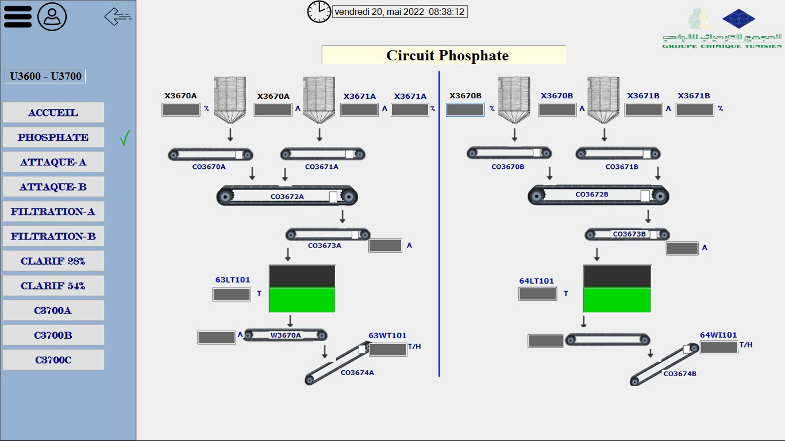
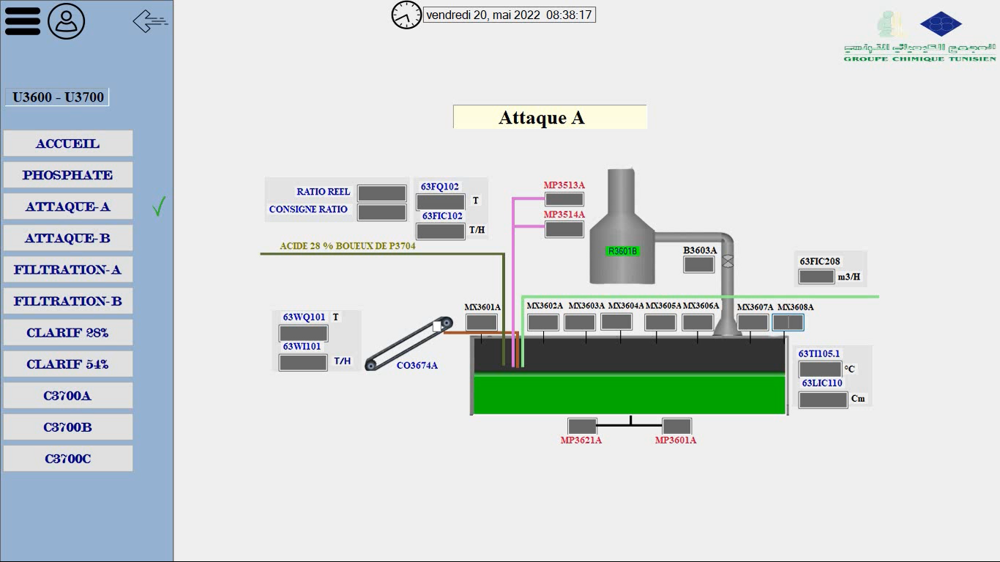
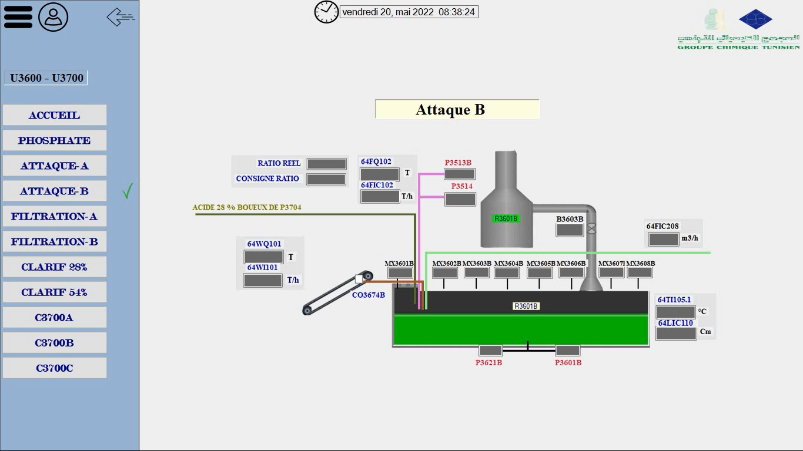
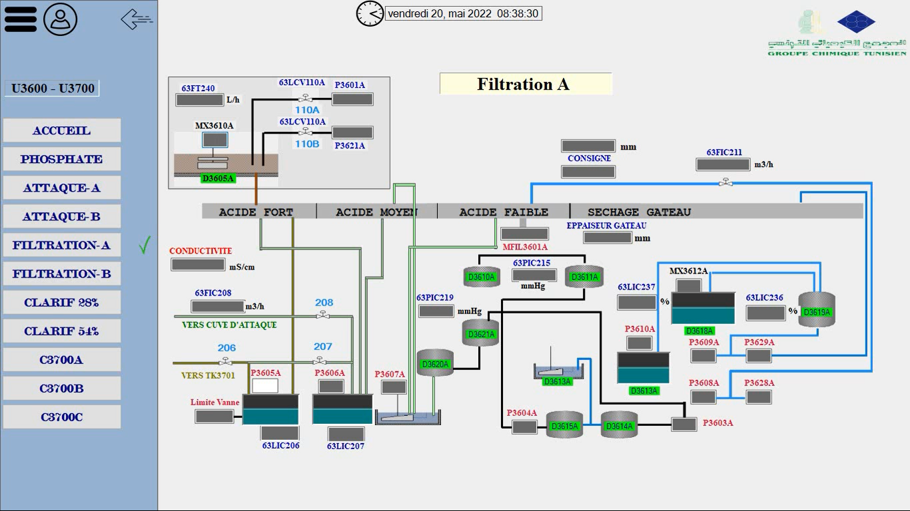
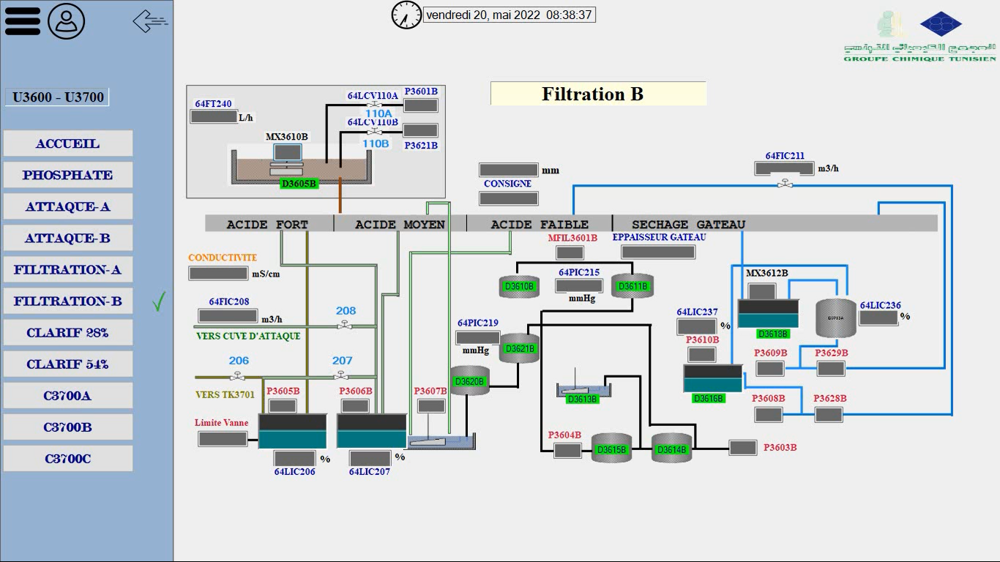
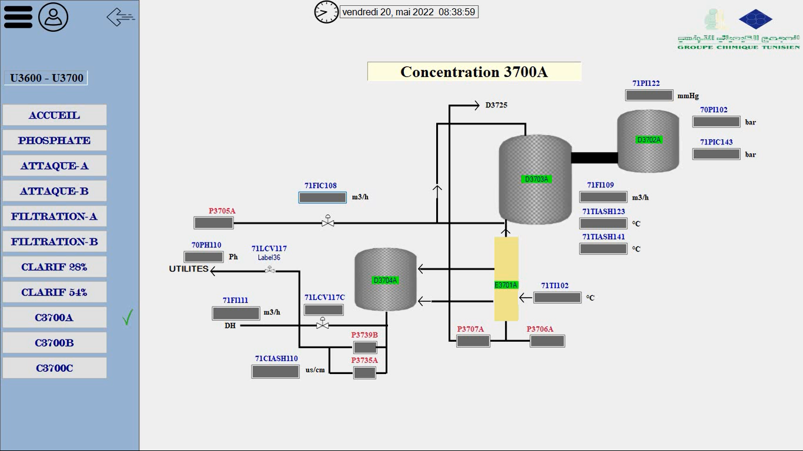
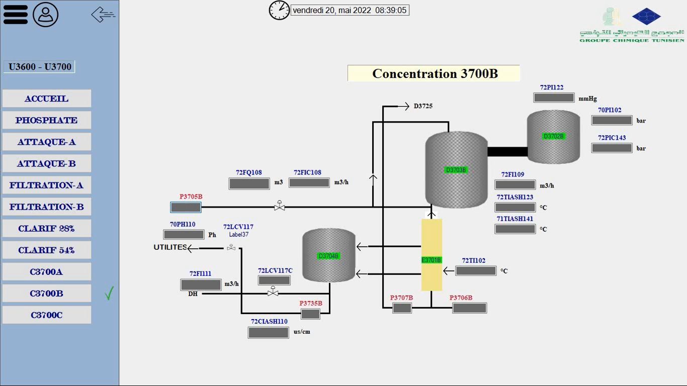
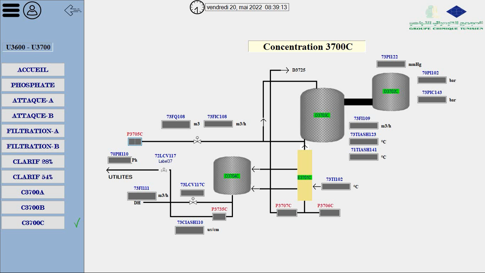
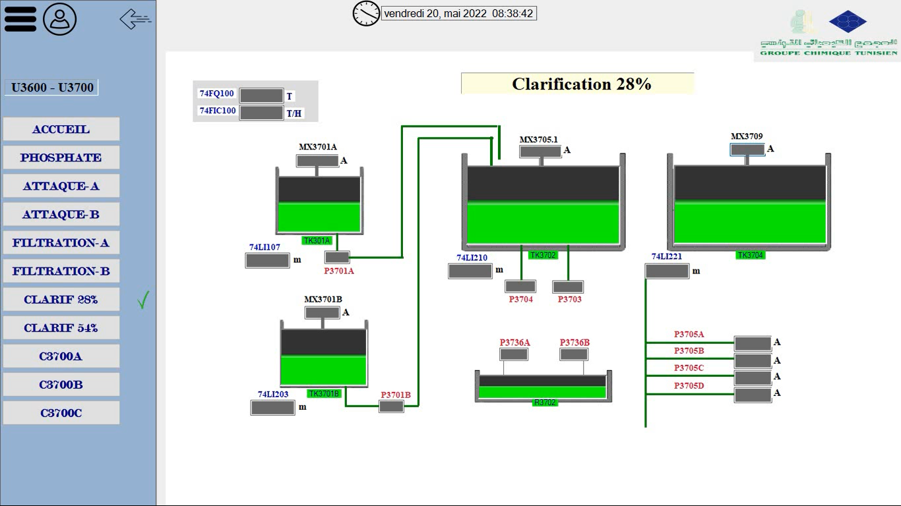
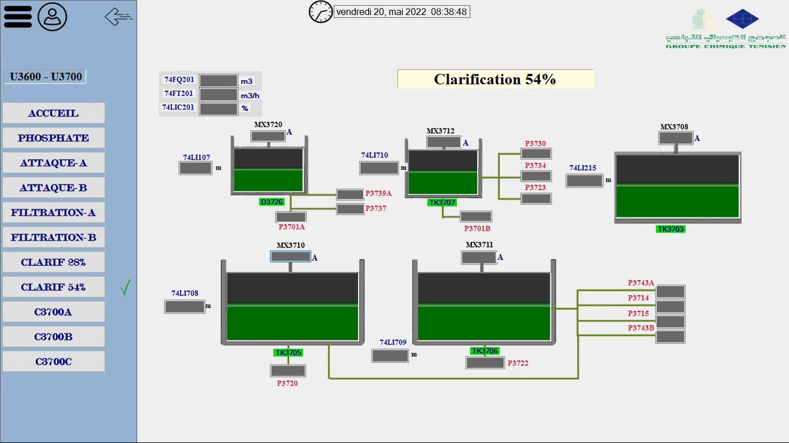

# GCT_v4 updated
Industry 4.0 Plateform
# GCT4 — Distributed Industrial SCADA & Multi-Site Supervision Platform

> **Industrial Automation & Distributed SCADA System for Groupe Chimique Tunisien (GCT)**
>
> Real-time data collection, DCS/PLC multi-protocol integration, data archiving, and dynamic plant process supervision built with **Visual Studio (VB.NET / C#)**, **KepServerEX (OPC UA/DA)**, **Rockwell Automation (ControlLogix)**, and **Foxboro DCS**.

##  Project Overview

**GCT4** is an enterprise-grade desktop SCADA (Supervisory Control and Data Acquisition) application designed and implemented for **Groupe Chimique Tunisien (GCT - CPA1 Plant, Gabès)**.

The platform bridges legacy Distributed Control Systems (**Foxboro DCS**) and industrial Programmable Logic Controllers (**Allen-Bradley ControlLogix PLCs**) into a single, unified client-server architecture. GCT4 replaces fragmented monitoring consoles with real-time process visualization, central alarm logging, historical trends, and automated report generation across six core chemical plant production units.

##  System Architecture

The architecture connects field-level industrial devices to top-floor management terminals via standard OPC interfaces and network protocols:

```
+-----------------------------------------------------------------------+
|                         FIELD LEVEL DEVICES                           |
|  +---------------------------------+  +----------------------------+  |
|  | Allen-Bradley ControlLogix      |  | Foxboro DCS (FBM242)       |  |
|  | 1756-L72 / 1756-ENBT Ethernet    |  | Modbus Field Interfaces    |  |
|  +---------------------------------+  +----------------------------+  |
+-----------------------------------|\----------------------------------+
                                    || Ethernet / Modbus
                                    \/
+-----------------------------------------------------------------------+
|                         COMMUNICATION MIDDLEWARE                      |
|                       KepServerEX (OPC UA / OPC DA)                   |
|              [Centralized Tag Management & Device Drivers]            |
+-----------------------------------|\----------------------------------+
                                    || OPC DA / OPC UA / Winsock UDP
                                    \/
+-----------------------------------------------------------------------+
|                         GCT4 SCADA APPLICATION                        |
|  +---------------------------+  +----------------------------------+  |
|  | Visual Studio (VB.NET/C#) |  | Local Historical Database        |  |
|  | HMI / Real-time Engine    |  | MS Access (ODBC) / OPC DataLogger|  |
|  +---------------------------+  +----------------------------------+  |
|  +---------------------------+  +----------------------------------+  |
|  | Alarm & Audio Warnings    |  | Excel Report Generator           |  |
|  +---------------------------+  +----------------------------------+  |
+-----------------------------------------------------------------------+
```

## Key Features

* **Multi-Unit Process Supervision:**

  * **Central Power Plant (Unité Centrale):** Turbo-generator sets (GTA 31351), seawater pumping station, gas boilers (SG-31301), steam distribution balance, aero-condensers, electrical grid sub-station.

  * **Sulfuric Acid Production Lines (Units A & B):** Sulfur burner furnaces, boiler feed systems, $SO_2 \rightarrow SO_3$ gas conversion loops, turbo-blowers (TB3501A/B), absorption towers.

  * **Phosphoric Acid Production (U3600-U3700):** Phosphate rock feeding/silos, reaction attack tanks, rotative filtration tables, $28\%$ and $54\%$ concentration loops, clarification units.

  * **DAP (Di-ammonium Phosphate) Plant:** Reaction & granulation circuits, rotary dryers, vibrating screens, cooling units, fuel oil burners.

* **Real-Time Data Acquisition & OPC Communication:**

  * Multi-driver interface connected via **KepServerEX** supporting OPC UA and OPC DA specs.

  * Sub-second polling rate ($1000\text{ ms}$) across $60+$ primary industrial process variables.

  * UDP-based client-server streaming for low-latency multi-terminal telemetry.

* **Alarm & Diagnostic Management:**

  * Threshold monitoring for electrical breakers, tank levels, and motor current draw.

  * Background sound alerts and visual notification counters for instant operator dispatch.

* **Historian & Automated Reporting:**

  * Integrated **DataLogger** writing process variables to MS Access (`eBD.mdb`) via ODBC.

  * Real-time trend visualization ($X/Y$ sensor charts updated every 3 minutes).

  * Automated Excel report generation and one-click printing module for production/consumption balance sheets.

* **Access Control & Network Security:**

  * Role-based access hierarchy (Super User / Plant Administrators / Unit Technicians).

  * Workstation lock-in using IP-based authentication to prevent cross-plant administrative access.

---

##  System Screens & Process Interfaces

### Phosphoric Acid Plant Interfaces (U3600 & U3700)

#### Overview Dashboard


#### Reaction & Attack Tanks
| Attack Tank A | Attack Tank B |
| :---: | :---: |
|  |  |

#### Filtration Units
| Filtration Line A | Filtration Line B |
| :---: | :---: |
|  |  |

#### Concentration Lines ($28\% \rightarrow 54\%$)
| Concentration Line A | Concentration Line B | Concentration Line C |
| :---: | :---: | :---: |
|  |  |  |

#### Clarification Units
| Clarification 28% | Clarification 54% |
| :---: | :---: |
|  |  |

---

##  Tech Stack & Hardware Components

### Software & Protocols

* **Languages:** VB.NET, C#

* **IDE:** Microsoft Visual Studio

* **Communication Middleware:** KepServerEX v4 / v6, OPC Expert

* **Protocols:** OPC UA, OPC DA, Modbus, TCP/IP, UDP, Ethernet/IP

* **Data Storage & Reporting:** MS Access (ODBC DSN), Microsoft Excel (VBA / Automation), OPC DataLogger Plugin

### Industrial Hardware & Field Devices

* **PLCs:** Allen-Bradley ControlLogix 1756-L72 CPU (4MB memory, 1756-A7 chassis)

* **Ethernet Communications:** Allen-Bradley 1756-ENBT/A module

* **I/O Modules:** 1756-IF16 (Analog Inputs), 1756-OFCI (Analog Outputs), 1756-IC16 (Discrete Inputs), 1756-OW16I (Relay Outputs)

* **DCS Integration:** Foxboro DCS (FBM242 Modbus interface module & Local Fox API)

* **Programming Tools:** Rockwell Studio 5000 / RSLogix 5000, RSLinx, RSView32

##  Repository Structure

```
├── docs/
│   ├── main_compressed.pdf               # Complete technical project report & thesis
│   ├── GCT4_SCADA_Platform_Report.pdf    # Platform specifications document
│   └── screenshots/                      # HMI screen captures
│       ├── phos.png
│       ├── attackA.png
│       ├── attackB.png
│       ├── filtA.png
│       ├── filtB.png
│       ├── cA.png
│       ├── cB.png
│       ├── cC.png
│       ├── clar28.png
│       └── clar54.png
├── src/
│   ├── GCT4_SCADA_App/                   # Visual Studio project source code
│   │   ├── Modules/
│   │   │   ├── VarGlobales.vb            # Global session and system variables
│   │   │   └── NetworkUtils.vb           # IP retrieval & authentication functions
│   │   ├── Forms/
│   │   │   ├── FrmLogin.vb               # Access control & IP validation
│   │   │   ├── FrmAccueil.vb             # Main navigation dashboard
│   │   │   ├── FrmUniteCentrale.vb       # Power plant & steam balance SCADA view
│   │   │   ├── FrmAcideSulfuriqueA.vb    # Line A Sulfuric acid process view
│   │   │   ├── FrmAcideSulfuriqueB.vb    # Line B Sulfuric acid process view
│   │   │   ├── FrmAcidePhosphorique.vb   # Phosphoric acid units (U3600/U3700)
│   │   │   ├── FrmUniteDAP.vb            # DAP reaction & granulation views
│   │   │   ├── FrmBilanHistorique.vb     # Excel report viewer & print controller
│   │   │   └── FrmTableauDeBord.vb       # Real-time sensor chart trends
│   │   └── Resources/                    # Audio alerts, icons, and UI assets
│   └── OPC_Library/
│       └── COPC32.dll                    # OPC DA client wrapper library
├── config/
│   ├── KepServerEX_Config.opf            # KepServer channel & tag definitions
│   └── ODBC_DSN_Setup.reg                # System DSN configuration for Access DB
└── database/
    └── eBD.mdb                           # Database schema for sensor logging
```

##  Setup & Configuration

### Prerequisites

1. Windows 10/11 Workstation.

2. Microsoft Visual Studio 2015 or newer (with .NET Framework desktop workload).

3. KepServerEX v4.0 or v6.x (with OPC DA / Allen-Bradley ControlLogix Ethernet drivers).

4. Microsoft Access Database Engine (32-bit/64-bit depending on runtime setup).

5. Microsoft Excel (for report generation modules).

### Step-by-Step Installation

1. **Clone the Repository:**

   ```bash
   git clone https://github.com/your-username/GCT4-Industrial-SCADA.git
   cd GCT4-Industrial-SCADA
   ```

2. **Configure OPC Communications (KepServerEX):**

   * Open KepServerEX and load the channel configuration from `config/KepServerEX_Config.opf`.

   * Configure the ControlLogix driver ID with your target PLC Ethernet IP:

     ```text
     Device ID: 10.10.145.1,1,0  # [IP Address],[Port],[CPU Slot]
     ```

   * Enable OPC Tag Auto-Generation to expose global tags (`A_MP3508A_09`, `ETAT_DISJ_DAP_B`, `LT408`, etc.).

3. **Database & DSN Registration:**

   * Register an ODBC System DSN named `SRC_DSN` pointing to `database/eBD.mdb` via Windows **ODBC Data Source Administrator (32-bit)**.

   * Enable the **DataLogger** plug-in in KepServerEX to point to `SRC_DSN`.

4. **Build the Visual Studio Solution:**

   * Open `src/GCT4_SCADA_App/GCT4_SCADA_App.sln` in Visual Studio.

   * Ensure `COPC32.dll` is correctly referenced in the project references.

   * Compile and run in `Release` mode.

##  Technical Code Highlights

### Real-Time OPC Data Polling & UI State Update

```vbnet
' Example: Reading pump current draw and status from KepServer OPC Library
MP3517A.Text = Math.Round(Axcopc1.GetV1(7), 2)
MP3518A.Text = Math.Round(Axcopc1.GetV1(8), 2)

' Evaluate Discrete State
If (Axcopc1.GetV1(9) = "True") Then
    MP3517A.ForeColor = Color.Lime
    ET_MP3517A.DiscreteValue2 = True
    ET_MP3517A.DiscreteValue1 = False
Else
    MP3517A.ForeColor = Color.Red
    ET_MP3517A.DiscreteValue2 = False
    ET_MP3517A.DiscreteValue1 = True
End If
```

### IP-Based Access Security

```vbnet
' Restricts login capability based on workstation IP registration
Public Function GetLocalIPAddress() As String
    Dim hostName As String = Net.Dns.GetHostName()
    Return Net.Dns.GetHostByName(hostName).AddressList(0).ToString()
End Function
```

##  Authors & Academic Context

* **Mohamed Aloui** — Industrial Electronics Engineer
* **Mazen Daghari** — Embedded Systems & Automation Engineer

**Academic Supervisors:**

* **Dr. Fayçal Hmidi** — Assistant Professor, ISSIG (Institut Supérieur des Systèmes Industriels de Gabès)
* **Eng. Walid Mizouri** — Industrial Mentor, Groupe Chimique Tunisien (GCT)

##  License

This project was developed for academic and industrial research purposes as part of a National Diploma Thesis in Industrial Electronics (2021/2022) at **ISSIG / University of Gabès** in collaboration with **Groupe Chimique Tunisien (GCT)**.
